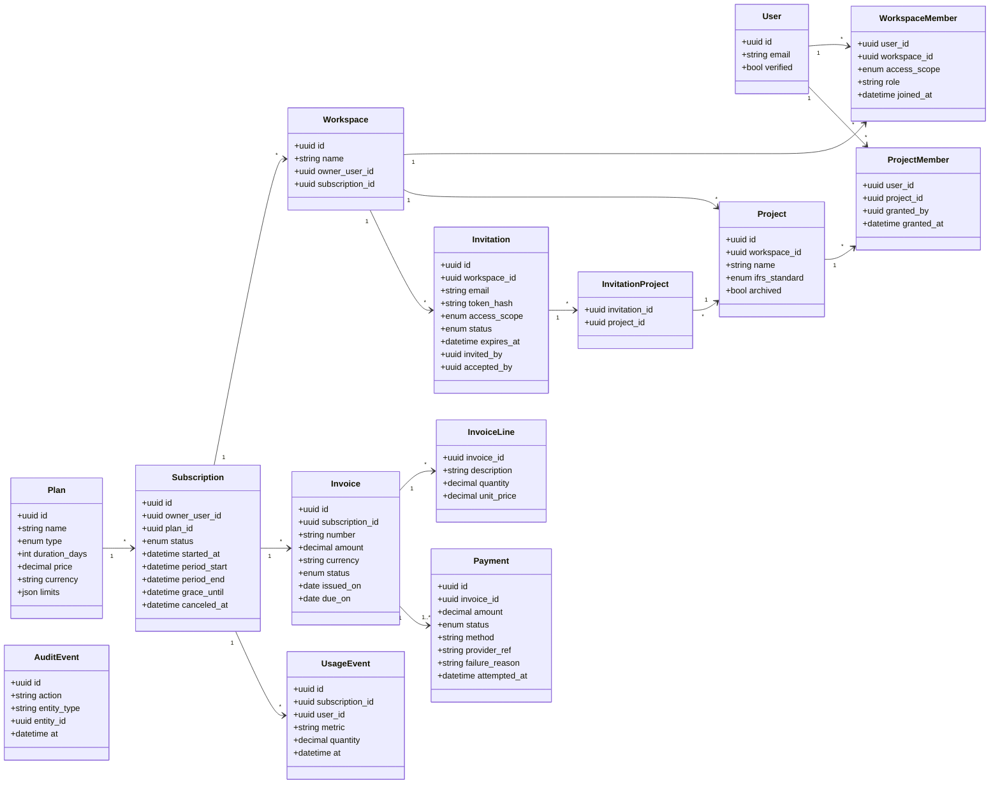
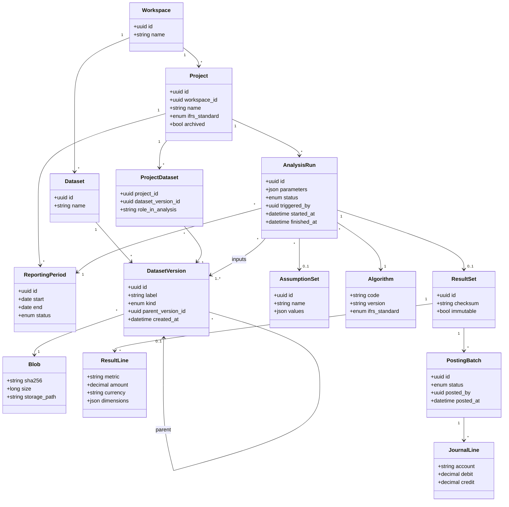
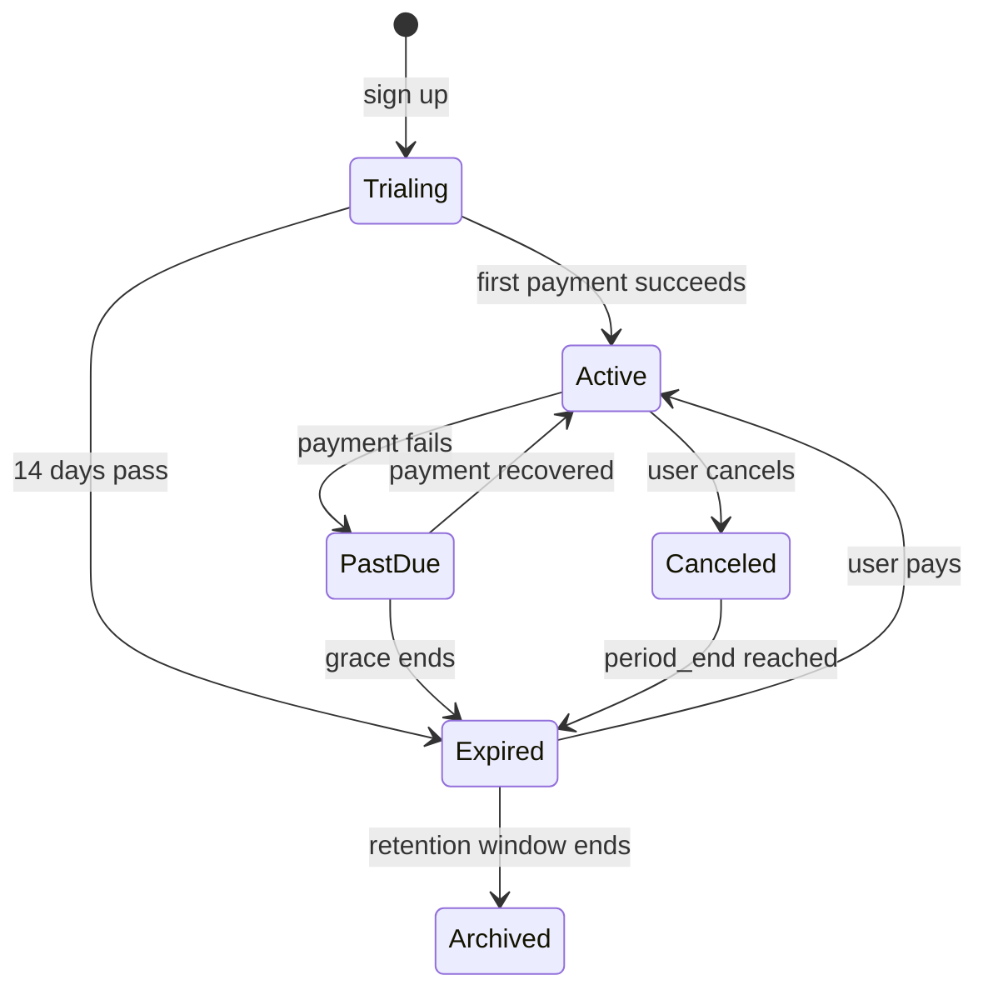
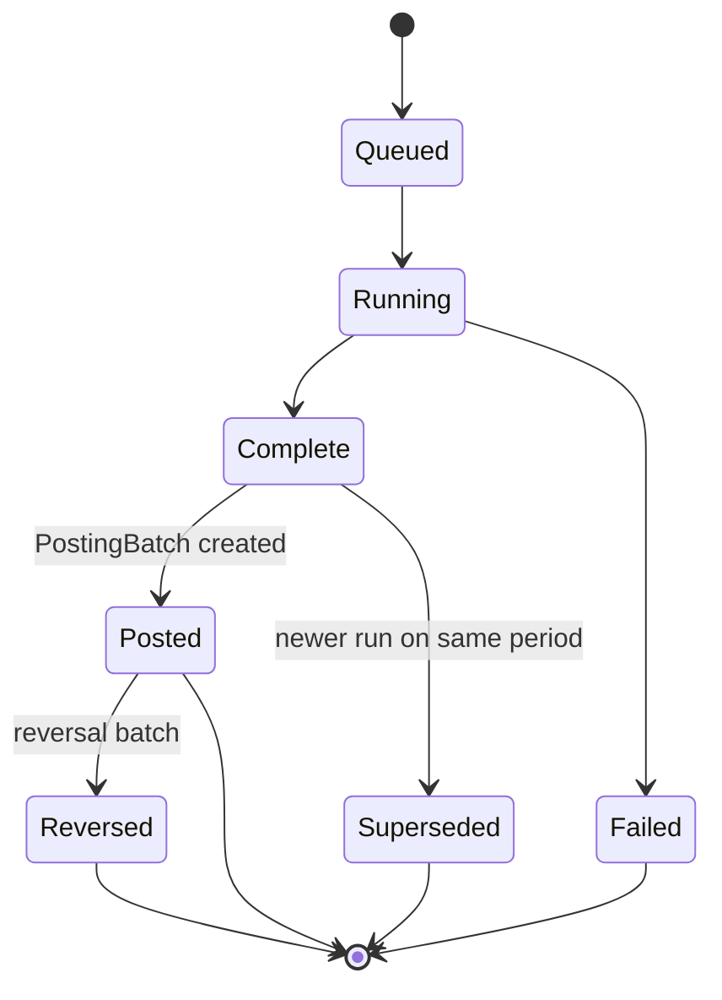
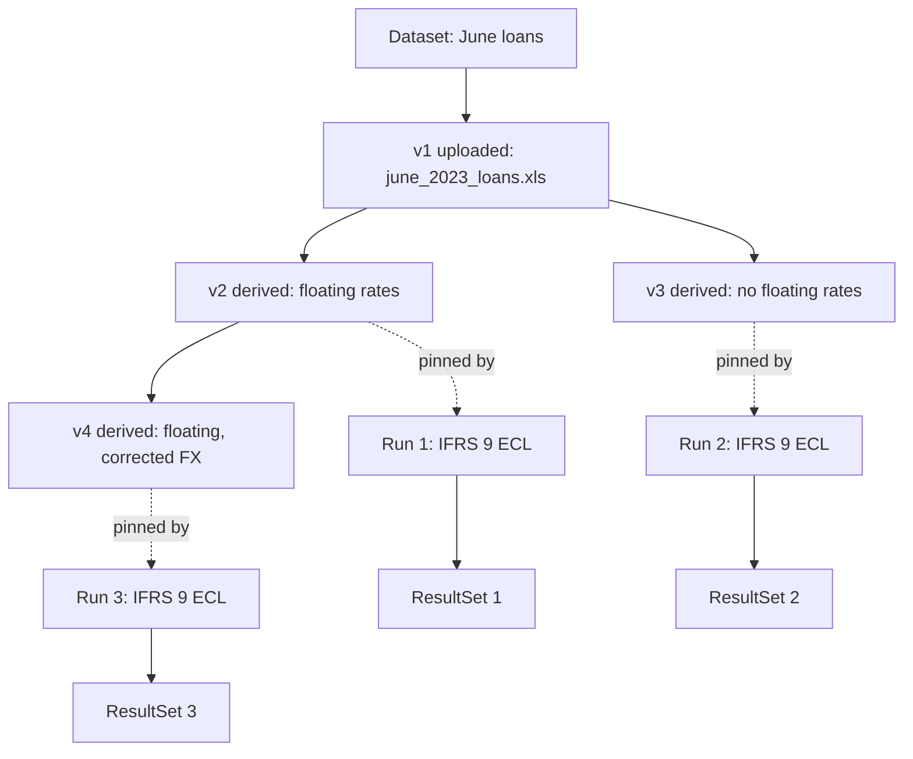
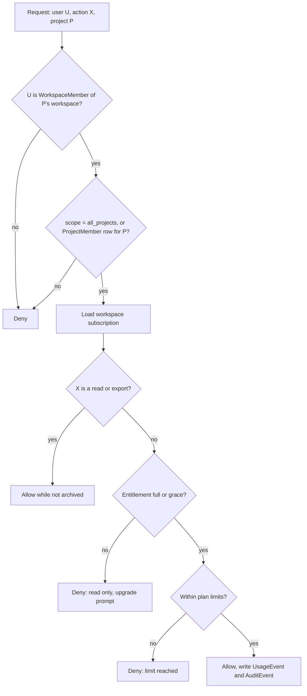
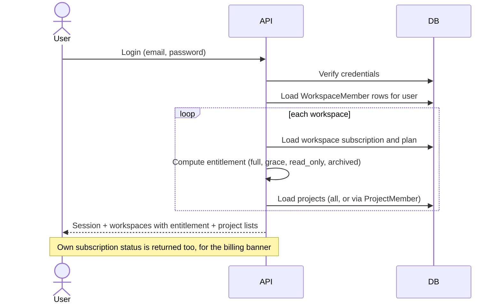
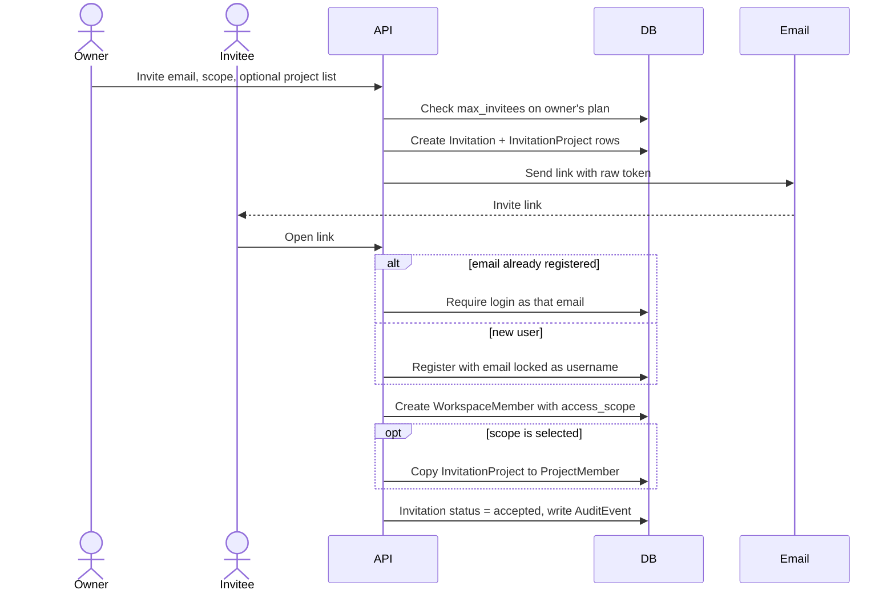
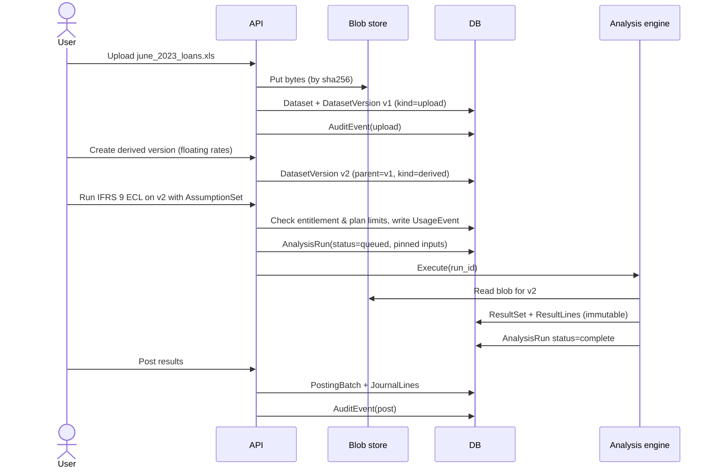

# IFRS Analysis Platform: Complete UML Specification (v2)

This document consolidates the core domain model (v1) with the updated access control, billing, and entitlement architecture (v2). It supersedes `Membership` and basic `Subscription` models from v1 while preserving the data versioning, IFRS analysis, and posting workflows.

---

## 1. Domain Class Diagrams

To maintain readability, the domain is split into two connected views: **Access & Billing** (v2) and **Data Versioning, IFRS Analysis & Posting** (v1 core).

### 1.1 Access Control, Collaboration & Billing

Being in a workspace and having access to a project are separate grants. `WorkspaceMember` grants visibility into the workspace, while `ProjectMember` grants access to specific projects unless `access_scope` is set to `all_projects`. Subscriptions live on the workspace owner; invitees ride on the owner's subscription.

#### Access Scope & Invariants

| `access_scope` | Meaning |
| --- | --- |
| `all_projects` | Sees every project in the workspace, including ones created later. No `ProjectMember` rows needed. |
| `selected` | Sees only projects with a `ProjectMember` row. A workspace with zero granted projects still lists, but shows empty. |

* **Invariants:** A `ProjectMember` row requires a `WorkspaceMember` row for the same workspace. Removing a `WorkspaceMember` removes their `ProjectMember` rows. Accepting an invitation copies `InvitationProject` rows into `ProjectMember` rows when `access_scope` is `selected`.

#### Plan Types & Trials

| `Plan.type` | Behavior & Constraints |
| --- | --- |
| `trial` | `duration_days = 14`, `price = 0`, no `Invoice` or `Payment` needed. One per user, enforced by a unique check on `owner_user_id`. |
| `demo` | Fixed sample data and tight limits (e.g., 1 workspace, 0 invitees, no posting). |
| `paid` | Monthly or annual billing; enforces limits such as `max_invitees`, `storage_mb`, and `runs_per_month`. |

* **Trial Upgrades:** Trials end by expiry, not by invoice. The same `Subscription` row moves to a paid `Plan` upon upgrade so workspaces keep pointing at the same subscription ID.

---

### 1.2 Data Versioning, IFRS Analysis & Posting

#### Key IFRS Domain Concepts
* **Algorithm:** Treated as data rather than code identity (`ifrs_standard`, `code`, `version`), ensuring every result explicitly records the logic that produced it.
* **AssumptionSet:** Stores discount rates, macro scenarios, and parameters separately from datasets so assumptions can vary without cloning underlying files.
* **ReportingPeriod:** Groups and locks runs and postings per accounting period.
* **PostingBatch:** Separates analytical output (`ResultSet`) from the accounting decision to book entries. Posted batches are immutable; corrections require reversal batches.

---

## 2. State Lifecycles

### 2.1 Subscription & Entitlement States

| Entitlement | Subscription State | Allowed Actions |
| --- | --- | --- |
| `full` | `Trialing`, `Active` | Everything within plan limits. |
| `grace` | `PastDue` (~7 days) | Everything within plan limits, accompanied by a payment warning banner. |
| `read_only` | `Expired`, `Canceled` | View projects, results, and history; download or export. No uploads, runs, postings, or invites. |
| `archived` | Post-retention (e.g., 90 days) | Data moved to cold storage; restorable upon payment or support request. |

### 2.2 Analysis Run Lifecycle

---

## 3. Data Versioning Tree ("Floating vs. No Floating" Case)

Dataset versions form a directed tree. Each `AnalysisRun` pins the exact `DatasetVersion` IDs it consumes so results always trace back to an immutable branch.

---

## 4. Authorization & Request Guard Flow

Every project-scoped API request passes through workspace membership, project scope, subscription entitlement, and plan limit checks before execution.

---

## 5. Sequence Diagrams

### 5.1 Login & Session Loading

Login does not gate on the user's personal subscription. Each workspace is evaluated against the subscription attached to that workspace, allowing invitees without their own paid plan to collaborate seamlessly.

### 5.2 Invitation with Project Grants

### 5.3 Upload, Version, Analyse & Post

